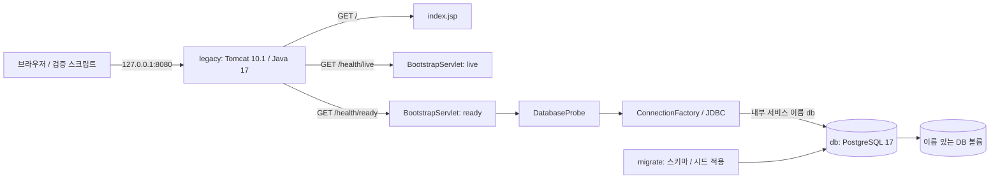

# Phase 0 — 구조와 요청 흐름

Phase 0 모듈은 단일 WAR와 PostgreSQL로 실행 환경을 확인합니다. 계좌, 입금, 출금 같은 은행 업무 모델은 후속 학습 모듈에서 제공합니다.

## 구성 책임

| 구성 | 책임 |
| --- | --- |
| 루트 `compose.yaml` | Phase 프로필, 서비스 의존성, 포트, 볼륨 관리 |
| `modules/00-bootstrap` | 정상 동작 기준 WAR와 Java 테스트 |
| `index.jsp` | Hello World HTML 출력 |
| `BootstrapServlet` | health URL 처리, HTTP 상태와 JSON 응답 결정 |
| `AppConfig` | 학습용 실행 설정 읽기와 검증 |
| `ConnectionFactory` | 연결 생성 경계를 나타내는 인터페이스 |
| `JdbcConnectionFactory` | JDBC 드라이버를 통한 실제 DB 연결 |
| `DatabaseProbe` | 초기 메타데이터가 기대한 상태인지 조회 |
| `database/migrations` | Phase 0의 `bootstrap` 스키마와 테이블 구조 |
| `database/seed` | 실제 고객정보가 없는 학습용 초기 데이터 |
| `exercises/starter/phase-00` | 학습자가 수정하는 미완성 SQL |
| `exercises/solutions/phase-00` | 선택해서만 여는 정답과 해설 |

Java 소스의 패키지는 `kr.banklearning.bootstrap`입니다. 연결을 인터페이스 뒤로 분리해 HTTP 계층에서 JDBC 상세 코드를 직접 처리하지 않고, 테스트에서 DB 동작을 대체할 수 있도록 합니다. 이 단계에는 별도 금융 도메인 계층이 필요하지 않습니다.

## 시작 순서

1. Compose가 DB 컨테이너와 영속 볼륨을 준비합니다.
2. DB health check가 접속 가능 상태를 확인합니다.
3. `migrate`가 버전 SQL과 seed를 순서대로 적용합니다. Phase 0의 소유 파일은 `V001__bootstrap.sql`과 `R001__bootstrap.sql`입니다.
4. 초기화가 성공하면 `legacy`의 WAR가 실행됩니다.
5. 애플리케이션의 ready 요청이 JDBC 연결과 실제 메타데이터 조회를 확인합니다.

DB 접속 가능 여부, 스키마 준비 여부, Java의 조회 성공 여부는 각각 다른 검사입니다. 시작 시 의존성 조건은 실행 순서를 정하고, ready 검사는 실행 후의 실제 사용 가능 상태를 확인합니다.

## 준비 상태 요청의 경로

`GET /health/ready`가 들어오면 Servlet은 `DatabaseProbe`를 호출합니다. Probe는 연결 팩토리에서 JDBC 연결을 얻어 `bootstrap.app_metadata`의 환경과 스키마 버전을 확인합니다. 연결과 결과 자원은 사용이 끝난 뒤 닫혀야 합니다. 환경은 `local-learning`, 스키마 버전은 `1`이 기준입니다.

DB 연결 실패나 잘못된 메타데이터는 준비 실패로 다룹니다. HTTP 응답과 애플리케이션 로그에 비밀번호, 전체 연결 정보, SQL 내부 예외를 그대로 노출하지 않습니다. 학습용 상태 점검에 필요한 결과만 외부에 제공합니다.

## 데이터와 실행 격리

Phase 0 데이터는 `bootstrap` 스키마가 소유합니다. 후속 Phase의 업무 테이블과 테스트 데이터는 별도 범위를 사용해야 합니다. 재실행하는 마이그레이션과 시드는 기존 학습 데이터를 임의로 삭제하는 초기화 수단이 아닙니다.

기본 빌드와 `phase0` 실행은 `modules/00-bootstrap`의 정상 코드만 사용합니다. 실습 SQL은 명시적으로 실습 검증 스크립트를 실행할 때만 읽습니다. 미완성 TODO나 정답을 WAR, 기본 화면, 기본 마이그레이션에 포함하지 않습니다.

단위 테스트 실행은 `test` 프로필, DB와 HTTP 실행은 `phase0` 프로필을 사용합니다. 로컬 테스트와 실제 DB·HTTP·재시작·종료 검증은 각각 기록하며 최신 결과는 루트 `PROGRESS.md`를 확인합니다. 수행하지 않은 검증을 완료로 표시하지 않습니다.
