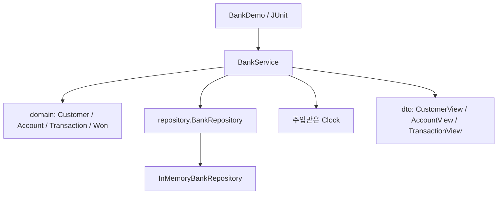

# Phase 1 — 메모리 업무 모듈의 구조

Phase 1의 실행 진입점은 `kr.banklearning.core.BankDemo`입니다. 웹 서버와 DB를 거치지 않고 Java 객체의 상태 변화와 업무 규칙을 검증합니다.

## 공개 API

| 메서드 | 역할과 결과 |
| --- | --- |
| `createCustomer(String)` | 고객을 생성하고 `CustomerView` 반환 |
| `openAccount(UUID)` | 존재하는 고객의 계좌를 잔액 0으로 개설 |
| `deposit(UUID, BigDecimal)` | 계좌 입금 후 `AccountView` 반환 |
| `withdraw(UUID, BigDecimal)` | 잔액을 확인해 출금 후 `AccountView` 반환 |
| `getAccount(UUID)` | 계좌의 현재 스냅샷 반환 |
| `accountsOf(UUID)` | 해당 고객의 계좌 목록 반환 |
| `history(UUID)` | 해당 계좌의 거래 내역 목록 반환 |

`CustomerView`는 고객 ID와 이름, `AccountView`는 계좌 ID·고객 ID·잔액을 제공합니다. `TransactionView`는 거래 ID·계좌 ID·입출금 유형·금액·거래 후 잔액·거래 시각을 전달합니다. 모든 ID는 UUID이며 학습 데이터만 사용합니다.

## 출금 호출 흐름 읽기

1. 서비스에서 계좌 ID와 출금액을 받습니다.
2. 저장소 경계를 통해 현재 계좌를 찾습니다.
3. 도메인이 원 단위 양수 금액인지, 잔액이 충분한지 검증합니다.
4. 성공하면 잔액 변화와 거래 기록이 함께 반영됩니다.
5. 서비스가 변경 후 상태를 DTO로 반환합니다.

실패한 출금은 잔액과 기록에 영향을 주지 않아야 합니다. 이 모듈의 메모리 구현 검증을 실제 DB의 트랜잭션 검증으로 해석하지 않습니다. DB 락, ACID, 중복 이체와 외부 금융기관 처리는 후속 단계에서 별도로 다룹니다.

## 저장과 소유 관계

한 고객은 여러 계좌를 가질 수 있습니다. 계좌는 소유 고객의 UUID를 보관하고 거래는 해당 계좌의 UUID를 보관합니다. 고객이 존재하지 않으면 계좌를 개설할 수 없습니다. 계좌별 목록을 조회할 때 다른 고객의 계좌나 다른 계좌의 거래가 섞이지 않아야 합니다.

도메인 객체와 저장소 내부 컬렉션은 외부에서 직접 변경하지 못하게 합니다. 호출자가 받은 DTO와 리스트는 조회 당시의 스냅샷이며, 이후 입출금은 새 조회 결과로 확인합니다.

## 실습 분리

`exercises/starter/phase-01`은 `WithdrawalPolicy`라는 작은 정책 함수만 가진 별도 JAR 모듈입니다. 정상 `BankService`는 이 TODO를 호출하지 않습니다. 기본 Maven 빌드에는 정상 모듈만 포함하고, 학습자가 `exercise-phase1` 프로필을 명시해야 실습이 실행됩니다. 정답 역시 별도 `solution-phase1` 프로필로만 선택합니다.

DB와 Compose 의존성이 없는 메모리 예제이므로 로컬 Java 실행을 검증할 수 있습니다. Docker 컨테이너 실행 여부는 따로 기록하며 대기 항목을 완료로 표시하지 않습니다.
