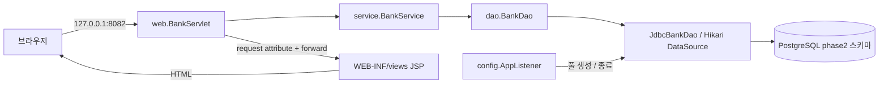

# Phase 2 — 웹 요청과 JDBC의 경계

DB 없는 화면 보조 실습은 [JSTL 실습 구조](jstl/architecture.md)를 참고합니다. 본문은 기존 DB 연결 정상 모듈의 구조입니다.

모든 Java 패키지는 `kr.banklearning.servlet` 아래에 있습니다. Servlet은 HTTP를, Service는 입력·업무 검증을, DAO는 SQL과 JDBC 자원을, JSP는 화면 표현을 담당합니다.

## URL과 호출 경로

| 요청 | 처리 |
| --- | --- |
| `GET /` | 고객 목록 URL로 redirect |
| `GET /customers` | 고객 목록 조회 → `customers.jsp` |
| `POST /customers` | 이름 검증 → 고객 등록 → 303 redirect |
| `POST /select-customer` | 존재하는 고객 검증 → 세션 저장 → 303 redirect |
| `GET /accounts` | 파라미터 또는 세션의 고객으로 조회 → `accounts.jsp` |
| `POST /accounts` | 고객 검증 → 잔액 0원 계좌 등록 → 303 redirect |
| `GET /history?accountId=...` | 계좌 및 거래 내역 조회 → `history.jsp` |
| `GET /health` | DAO 준비 상태를 확인해 JSON과 HTTP 상태 반환 |

등록 요청은 먼저 세션 CSRF 검증을 통과해야 합니다. 입력 오류는 400, 토큰 오류는 403, 없는 데이터는 404, 저장소 사용 불가는 제한된 메시지와 503으로 반환합니다. SQL 내부 예외나 자격 증명을 응답에 포함하지 않습니다.

## 데이터 경계

- `phase2.customer`: 고객 ID, 이름, 상태
- `phase2.account`: 계좌 ID, 소유 고객 ID, 원 단위 잔액
- `phase2.transaction_history`: 거래 ID, 계좌 ID, 유형, 금액, 거래 후 잔액, 시각

외래 키는 고객→계좌→거래의 소유 관계를 유지합니다. 정상 조회와 등록은 `phase2` 스키마만 사용하며 Phase 0과 후속 Phase의 데이터를 덮어쓰지 않습니다. `V002__servlet.sql`은 구조를 만들고 `R002__servlet.sql`은 가상 고객과 최초 거래를 제공합니다.

## 계좌 조회 추적

`GET /accounts` → `BankServlet.doGet` → `BankService.accounts` → `JdbcBankDao.accounts` → PreparedStatement 실행 → ResultSet 매핑 → `BankViews.AccountView` 목록 → request attribute → JSP EL/JSTL 순서로 읽습니다.

파라미터가 제공되면 검증한 고객 ID를 조건으로 조회합니다. 파라미터가 없으면 세션의 선택 고객을 사용합니다. 화면의 전체 조회 링크는 빈 파라미터를 전달해 전체 목록을 요청합니다. request와 session의 유효 범위를 구분해 흐름을 따라가세요.

## 풀과 생명주기

`AppListener`는 WAR 시작 시 환경변수로 HikariCP를 만들고 `BankService`를 ServletContext에 등록합니다. DAO는 매번 풀에서 연결을 빌려 쓰고 try-with-resources로 반환합니다. 종료 시 풀을 닫고 해당 WAR가 등록한 JDBC 드라이버를 정리합니다.

정상 WAR는 실습 `CustomerNameValidator`와 `.jsp.txt`를 포함하지 않습니다. 학습 실습은 명시적으로 선택하는 별도 Maven 모듈이고, 레거시 자료는 실행되지 않는 텍스트입니다.
