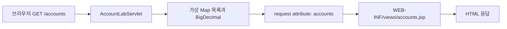

# 화면 실습의 구조

`exercises/jstl-bank-lab`은 실습 전용 WAR 모듈입니다. 루트 기본 모듈에는 포함하지 않으며 `jstl-lab` Maven 프로필 또는 해당 POM 직접 실행으로 선택합니다. 기존 정상 Phase 2 WAR와 DB 스키마를 변경하지 않습니다.

Servlet은 데이터 준비와 forward만 담당합니다. JSP의 EL은 request attribute의 목록과 Map 항목을 읽습니다. 실제 DB DTO에 연결할 때는 가상 데이터 공급 부분을 Service 호출로 바꾸고, JSP의 표현 계약은 유지할 수 있습니다.

starter JSP는 `exercises/starter/phase-02/jstl`에 있습니다. WAR 빌드 시 이 디렉터리의 JSP만 `WEB-INF/views`에 넣습니다. 기본 실습 실행은 starter만 사용하고 정답 파일은 읽지 않습니다. 정답은 별도 선택 프로필로만 사용하며 WAR 이름과 전개 디렉터리도 분리합니다. 정답 실행법과 해설은 정답 디렉터리에만 둡니다.

로컬 미리보기와 HTTP 테스트는 테스트 소스의 `LabServer`에서 내장 Tomcat과 Jasper를 실행합니다. `WEB-INF` JSP는 URL로 직접 읽지 못하며 `/accounts` Servlet을 거쳐야 합니다. 내장 서버, JUnit, 테스트 클래스는 WAR에 포함되지 않습니다. 로컬 JSP는 파일을 직접 읽으므로 수정 후 새로고침할 수 있습니다.

Compose의 `jstl-lab` 프로필은 Tomcat 10.1 / JDK 17 컨테이너로 starter WAR만 실행합니다. PostgreSQL이나 migration 서비스에 의존하지 않습니다. 외부 포트는 기본 `127.0.0.1:8087`입니다.
