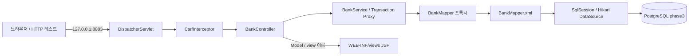

# Phase 3 — 컨테이너 구성과 호출 구조

## 두 설정 영역

| 영역 | 구성과 책임 |
| --- | --- |
| `WebInitializer` | root 설정과 web 설정을 등록하고 DispatcherServlet 매핑 |
| `RootConfig` / `root-context.xml` | Service, 풀, SqlSessionFactory, Mapper, TransactionManager |
| `WebConfig` | MVC 활성화, Controller 스캔, JSP ViewResolver, CSRF Interceptor |

서비스와 저장소는 root context에, MVC 구성은 servlet context에 둡니다. 생성자 주입을 통해 어떤 의존성이 필요한지 소스에서 읽을 수 있습니다.

## 요청별 경로

| 요청 | 처리 |
| --- | --- |
| `GET /customers`, `POST /customers` | 고객 조회·등록 |
| `POST /customers/status` | ID와 상태를 검증해 ACTIVE/SUSPENDED 변경 |
| `GET /accounts`, `POST /accounts` | 고객별 계좌 조회·등록 |
| `GET /history?accountId=...&from=...&to=...` | 계좌별 선택 기간 거래 조회 |
| `GET /health` | Mapper를 통해 스키마 준비 상태 확인 |

모든 상태 변경 폼은 CSRF 검증 후 Controller로 들어옵니다. Controller는 HTTP 입력을 서비스에 전달하고 서비스는 형식·존재·업무 상태를 검증합니다. Mapper XML은 실제 SQL과 결과 DTO 매핑을 소유합니다.

## 거래 기간 조회 흐름

Controller의 `from`, `to` 문자열 → Service의 LocalDate 검증 → Asia/Seoul 기준 OffsetDateTime 범위 변환 → Mapper의 `fromInclusive`, `toExclusive` → XML 동적 조건 → transaction resultMap → JSP 순서입니다.

예를 들어 화면에서 2026-10-01~2026-10-31을 선택하면 내부 범위는 `2026-10-01T00:00+09:00` 이상, `2026-11-01T00:00+09:00` 미만입니다. 양 끝의 날짜를 포함하면서 시각의 소수 정밀도에 의존하지 않습니다. 시작 또는 종료가 비어 있으면 해당 조건을 생략합니다. 시작일이 종료일보다 늦으면 400입니다.

## 트랜잭션과 데이터 소유

`phase3.customer`, `phase3.account`, `phase3.transaction_history`는 이 모듈 전용입니다. Phase 2 JDBC 코드와 데이터는 그대로 보존합니다. `@Transactional`은 Spring이 제공하는 서비스 Bean을 거쳐 호출되어야 적용되며, 테스트에서 직접 `new BankService(...)`를 만든 경우 DB 트랜잭션 검증으로 볼 수 없습니다.

MyBatis와 TransactionManager는 같은 Hikari DataSource를 참조합니다. Mapper가 SQL을 실행하는 연결과 트랜잭션을 관리하는 연결이 같은 경계에 있어야 합니다.

## 실습 격리

starter의 `HistoryMapper`는 정상 `BankMapper`와 다른 namespace와 별도 Maven 모듈을 사용합니다. 테스트는 XML의 BoundSql과 값 바인딩을 DB 없이 확인합니다. 정상 WAR와 기본 마이그레이션은 실습 Mapper나 정답을 읽지 않습니다.
