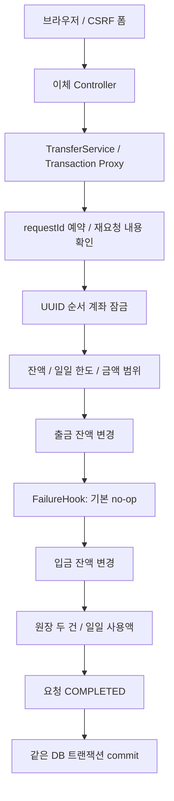
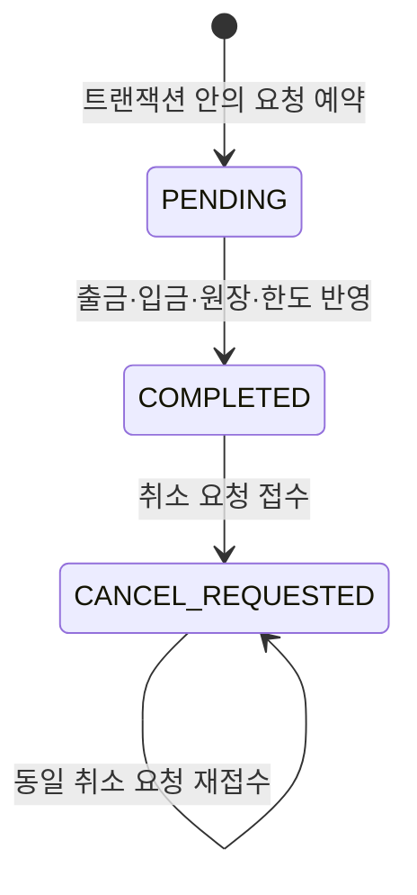

# Phase 4 — 이체 처리와 DB 경계

주요 Java 패키지는 `kr.banklearning.transaction`입니다. `service.TransferService`는 업무 순서를, `repository.JdbcTransferRepository`는 JdbcTemplate SQL과 잠금을 소유합니다. `domain.TransferCommand`, `TransferReceipt`, `Account`, `LedgerEntry`가 입력과 결과를 전달합니다.

## 단일 이체의 경계

서비스는 요청·계좌 UUID, 서로 다른 두 계좌, 양수 원 단위 금액을 검증합니다. DB 요청 예약 후 같은 ID가 이미 존재하면 거래 내용을 비교합니다. 새로운 요청이면 두 계좌를 DB UUID 순서로 잠그고 현재 잔액과 한도를 검증합니다.

출금, 입금, 원장, 일일 사용액, 완료 상태가 동일 트랜잭션 안에서 반영됩니다. 중간 오류가 경계 밖으로 전파되면 모든 변경이 rollback되어야 합니다. 실제 트랜잭션은 Spring 서비스 Bean의 프록시를 통해 호출해야 적용됩니다. 저장소 대역으로 서비스만 직접 생성한 테스트는 DB rollback 검증이 아닙니다.

## 데이터 소유

| `phase4` 테이블 | 소유하는 상태 |
| --- | --- |
| `customer` | 가상 고객 |
| `account` | 잔액, 일일 한도, version |
| `transfer_request` | 요청 ID, 출입금 계좌, 금액, 업무 날짜, 처리 상태 |
| `ledger` | 요청별 출금·입금 내역과 거래 후 잔액 |
| `daily_usage` | 출금 계좌·Asia/Seoul 업무 날짜별 누적 사용액 |

요청 ID의 기본 키와 요청·계좌별 원장 유일성은 중복 결과를 제한합니다. 누적 한도 갱신은 같은 출금 계좌 잠금 경계 안에서 수행합니다. seed는 초기 잔액만 제공하며 완료 요청이나 원장을 만들어 이체가 있었던 것처럼 표시하지 않습니다.

## 잠금 순서

두 계좌의 `ORDER BY id FOR NO KEY UPDATE`는 이체 방향과 관계없이 같은 계좌부터 잠그기 위한 구성입니다. 외래 키의 KEY SHARE와 호환하면서 잔액 갱신을 직렬화합니다. 더 강한 잠금을 무조건 선택하기보다 실제 갱신하는 열과 다른 잠금 경로를 함께 검토합니다.

상태 변경과 취소 요청은 해당 요청 행을 잠가 확인합니다. 계좌, 요청, 다른 자원까지 이어지는 전체 잠금 순서를 확인해야 하며 단일 정렬 함수만으로 모든 deadlock이 사라졌다고 판단하지 않습니다.

## 상태와 취소 요청

처리 실패는 같은 트랜잭션의 예약과 함께 rollback됩니다. `CANCEL_REQUESTED`는 접수 상태이며 원장 취소·잔액 환급·한도 복원을 수행하지 않습니다. 완료 이체를 되돌릴 정책은 별도 업무 설계가 필요합니다.

## 검증용 실패 주입

`FailureHook.afterDebit`는 기본 실행에서 아무 작업도 하지 않습니다. 실제 DB 통합 테스트에서 테스트용 훅을 주입해 출금 직후 오류를 재현합니다. 기본 폼이나 HTTP 파라미터로 실패를 켜지 않습니다. 오류 뒤 잔액뿐 아니라 요청·원장·일일 사용액을 함께 검사해야 합니다.
