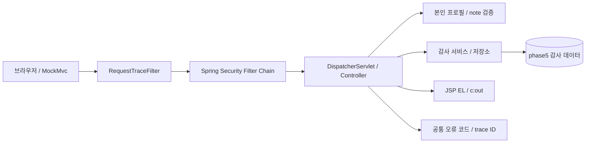

# Phase 5 — 보안과 관찰 경계

정상 패키지는 `kr.banklearning.operations`입니다. 추적 ID, 인증·인가, CSRF, 업무 입력, 감사 저장, 표현을 순서대로 분리해 읽습니다. 보안 필터가 거절한 요청과 Controller 내부 오류가 공통된 추적 경로를 가지는지도 확인합니다.

## 접근 경로

| 경로 | 접근과 책임 |
| --- | --- |
| `GET /health` | 공개 상태 점검 |
| `/login` | 폼 로그인 |
| `GET /profile` | 인증한 자신의 프로필 |
| `POST /profile/note` | 인증·CSRF·길이 검증 후 본인 note 처리 |
| `GET /admin/audit` | ADMIN 역할의 감사 조회 |
| `GET /csrf` | 인증된 클라이언트의 CSRF 토큰 조회 |

폼 로그인은 세션 인증을 사용하고 HTTP Basic은 요청 헤더로 인증할 수 있습니다. 세션 기반 검증에서 Basic 헤더를 계속 보내면 만료 후에도 새 인증이 가능하므로 두 경로를 나누어 관찰합니다.

## 데이터와 로그

정상 감사 저장소는 PreparedStatement 값 바인딩을 사용합니다. 로그에는 SQL 템플릿과 제한된 작업·결과·trace 정보를 남기며, 입력 note·계좌 원문·자격 증명을 그대로 기록하지 않습니다. 화면은 이미 저장된 값도 출력할 때 이스케이프합니다.

RequestTraceFilter의 허용 형식은 응답 추적 ID와 오류 코드의 연결을 위한 경계입니다. 외부 입력을 그대로 로그 한 줄로 신뢰하지 않습니다. 마스킹은 정해진 위치의 값만 표시하는 별도 정책입니다.

## 정상 코드와 장애 fixture

`src/main`에는 정상 보안 기능을 둡니다. `src/test/.../labs/MaintenanceLabTest`는 DB 없는 축소 재현이고 `MaintenanceLabIT`는 `phase5_lab` fixture 데이터를 사용하는 실제 DB 재현입니다. 기본 WAR에 시험용 오류 경로나 랩 클래스를 넣지 않습니다.

기본 단위 테스트, 선택 Failsafe IT, 별도 마스킹 TODO 모듈은 서로 다른 검증 대상입니다. 소스가 존재한다는 사실을 실제 Docker·DB 실행 성공으로 기록하지 않습니다.
