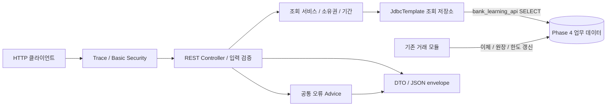

# Phase 6 — 조회 API와 기존 거래 경계

화면 보조 과제의 데이터와 실행 경계는 [JSTL 구조](jstl/architecture.md)를 참고하세요. 본편 애플리케이션 구성은 유지합니다.

정상 패키지는 `kr.banklearning.api`, 실행 진입점은 `BankApiApplication`입니다. 기존 거래 모듈과 실행 프로세스, DB 역할을 분리합니다. API가 사용하는 테이블의 소유권은 기존 모듈에 있습니다.

## 조회 경로

| 경로 | 읽는 정보 |
| --- | --- |
| `/api/customers/{id}` | 고객 기본 정보 |
| `/api/accounts/{id}` | 계좌와 소유 고객, 잔액, 한도, version |
| `/api/accounts/{id}/transactions` | 해당 계좌의 제한된 건수 거래 목록 |
| `/api/accounts/{id}/limit` | 업무 날짜별 한도·사용액·남은 한도 |
| `/api/admin/statistics` | 관리자용 기간별 이체 건수·금액 |
| `/health` | 공개 DB 준비 상태 |

기간 검색은 API 입력의 ISO 날짜를 Asia/Seoul 시작 포함·끝 제외 시각으로 바꿉니다. 통계는 업무 날짜의 양 끝을 포함하고 최대 366일을 허용합니다. 단일 조회 최대 건수는 200이며 cursor·offset·다음 페이지 정보는 제공하지 않습니다.

## 인증과 소유 범위

Basic 인증은 요청마다 자격 증명을 검사하고 세션 상태를 유지하지 않습니다. `learner` USER는 고정된 가상 고객 `40000000-0000-0000-0000-000000000001`과 그 소유 계좌만 조회합니다. `admin` ADMIN은 전체 조회와 통계에 접근합니다. 조회 대상과 principal의 관계는 서비스에서 검증합니다.

## 응답과 오류

표준 envelope는 성공 데이터 또는 안전한 오류와 requestId를 담습니다. 요청 추적 헤더는 허용 형식만 재사용하고 잘못된 입력은 새 값으로 교체합니다. Advice와 보안 오류 처리기가 원본 SQL, 예외 객체, 자격 증명을 응답에 포함하지 않도록 합니다.

## 읽기 권한과 일관성

DB는 별도 조회 역할에 제한된 SELECT 권한만 부여합니다. 정상 API의 GET 경로는 거래를 접수하거나 한도를 소비하지 않습니다. DB 연결 계정과 애플리케이션 readOnly 정책을 각각 확인합니다. API에 새 쓰기 기능을 추가하려면 기존 거래·멱등성·원장 소유 경계를 먼저 다시 설계해야 합니다.

둘 이상의 읽기로 한 응답을 조립하면 중간 commit에 따라 다른 시점의 값이 섞일 수 있습니다. `BankReadService.limit`는 REPEATABLE_READ 읽기 트랜잭션에서 계좌의 한도와 당일 사용액을 조회하도록 구성합니다. 나머지 서비스의 기본은 readOnly와 DB 기본 격리 수준입니다. 통계는 단일 SQL로 집계합니다. 소유권·일관성 검증의 범위는 [연계 문서](../../docs/architecture/legacy-api-ownership.md), 실제 PostgreSQL 실행 결과는 루트 `PROGRESS.md`를 확인합니다.

## 검증 분리

JUnit/Mockito와 HTTP 단위 테스트는 API 분기와 계약을 확인합니다. 실제 DB IT는 조회 역할의 쓰기 거절, UUID·금액·시각 매핑과 데이터 범위를 확인합니다. Docker 실행은 별도 프로필 `phase6`이며 기본 API JAR에 starter·정답을 포함하지 않습니다.
